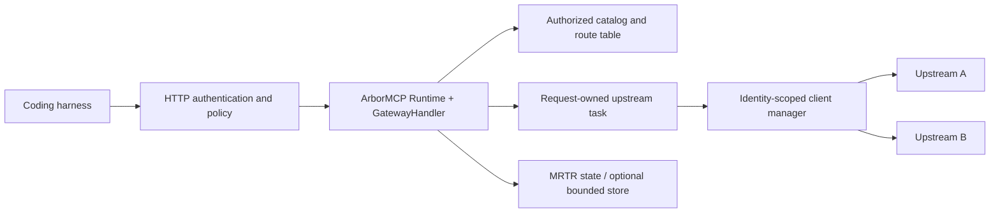

# MCP forwarding gateway — design draft

Status: proposal for discussion; no gateway application is implemented by this
document. Updated 2026-10-31 against ArborMCP master `16f1e0b` (`2.0.0-rc.7`).
Audience: maintainers and implementers of the gateway.

Stage 0 now has a controlled embedded example and HTTP tests using existing
public APIs. The [Stage 0 record](GATEWAY_STAGE0.md) distinguishes exercised
behavior from open production, pressure and host-integration gates. The rest
of this document remains a design proposal; the example is not a general
gateway product.

## Purpose and existing work

Expose one MCP endpoint to a coding harness and route its tool calls to several
upstream MCP servers on behalf of the signed-in person. The gateway presents an
authorized tool catalog, preserves tool results and interactive requests, and
owns the work it starts until completion or confirmed cleanup.

[Issue #92](https://github.com/trust-arbor/arbor_mcp/issues/92) proposed the client
hooks for this use case. It did not specify a complete gateway product. Its
[identity clarification](https://github.com/trust-arbor/arbor_mcp/issues/92#issuecomment-6506994398)
uses one client per signed-in user, gateway OAuth client, upstream application
and MCP URL. The maintainer also chose to start with clients isolated by user.
This draft adopts that boundary and adds the missing application design.

Before this draft, there was no forwarding-gateway design in the repo. The historical
`docs/V2_HTTP_GATEWAY_SLICE.md` describes the server Runtime's HTTP dispatch and
output machinery. That internal gateway remains part of serving a single MCP
server; it is not the service proposed here.

The following foundations are already available:

| Foundation | Existing support |
| --- | --- |
| Concurrent upstream calls | Each modern HTTP request has independent work; #163. |
| Caller lifetime | Modern calls cancel when their caller exits by default; #164. |
| Interactive forwarding | Manual multi-round-trip requests (MRTR), continuation options and per-request capabilities; #162. |
| Progress forwarding | `progress_to:` delivers `{:arbor_mcp_progress, client, token, params}`; #187. |
| MRTR interoperability | Downstream retries may change progress token; keep a stable token toward other upstream implementations; #174. |
| Discovery privacy | Configurable discovery cache hints; #175. |
| Dynamic schema lookup | `handle_get_tool/2` supplies exactly the definition listed for a tool. |
| Failure handling | Provider-token failures, delivery classification, session expiry and typed startup errors; #188–#190, #193 and #196. |

See [forwarding clients](CONFIGURATION.md#forwarding-clients-mcp-2026-07-28),
[progress routing](PROTOCOL_GUIDE.md#progress-to-another-process),
[Runtime ownership](RUNTIME_GUIDE.md), and [outbound trust](SECURITY.md).
Existing hooks are building blocks; they do not provide gateway authorization,
catalog aggregation, connection pooling or an end-to-end gateway guarantee.

## Proxy mode and deployment are separate choices

The fork's [proxy-mode documentation commit](https://github.com/altow-de/arbor_mcp/commit/6c2b686533730ef195544d924dd4cd7631367772)
describes per-request client options, backed by the preceding commits on that
branch. It does not add a runnable proxy server, deployable application or a
separate service requirement. Current master and the published `2.0.0-rc.7`
already implement the core forwarding features, with deliberate contract
changes agreed in #92:

| Fork capability | Current contract |
| --- | --- |
| Manual MRTR and continuation data | Supported for tools, resource reads and prompts. An unfinished round returns `{:input_required, %{input_requests: ..., request_state: ..., meta: ...}}`, rather than the fork's `{:ok, raw_input_required_result}`. |
| Per-request capabilities | Supported on modern requests. A request that can return input requires `mrtr: :manual`; legacy per-request overrides are explicitly refused instead of silently ignored. |
| Per-call progress | Supported. The message includes the client PID, `{:arbor_mcp_progress, client, token, params}`, and delivery is alongside the client handler rather than replacing it. |
| Cancellation on caller exit | Supported; enabled by default for modern requests. Modern HTTP closes its stream without a second cancellation notification; legacy cancellation is opt-in. |
| Concurrent requests through one modern HTTP client | Supported for all requests, not just requests using proxy options. |
| Nil request options | Unset options retain current defaults. |

The fork's example therefore needs adaptation to the current contract, rather
than being copied unchanged. Keep one explicit upstream progress token across
manual rounds; the fork's example generates a new token each time its forwarding
function is entered, which is not sufficient for a resumable logical call.

One current limitation matters before promising a general-purpose proxy:
`Client.read_resource/3` supports manual MRTR but does not put an explicit
progress token on its request. Consequently, a manual resource read cannot
combine `progress_to:` or `reset_timeout_on_progress` with a stable token; the
public API returns a validation error. Tools and prompts can supply the token.
This restriction is documented and tested. Supporting progress for manually
forwarded resource reads needs an explicit API proposal and regression tests;
it is not a missing tools-forwarding hook. End-to-end HTTP gateway/harness
coverage is also distinct from the existing forwarding unit/integration tests.

A forwarding handler, its Runtime and upstream clients can run under an
existing Arbor application's supervisor and HTTP endpoint. No additional OS
process, BEAM VM or deployment is required. Routing, authorization and MRTR
relay logic still have to be supplied by that application. The same component
could later be wrapped in a standalone service if independent scaling,
credentials administration or deployment ownership justify it.

The next work should establish forwarding coverage and close required library
gaps first. Standalone deployment is optional, and is not a prerequisite for
using proxy mode.

## Proposed embedded solution

Recommend first building a reusable forwarding component and an example hosted
by an existing OTP application. An embedded implementation that satisfies the
actual use case can be the finished solution. A successful prototype does not
oblige us to build a separate gateway product, new service layers or standalone
wrapper. The earlier standalone-first recommendation is superseded; no separate
repository/package is assumed. `ArborGateway` below is a provisional namespace.

Reuse the host's authentication, credential providers, endpoint and supervised
clients wherever they already meet the forwarding requirements. The component
roles and larger-scale mechanisms below are design options for gaps the host
does not cover, not a requirement to rebuild those facilities. Authorization
isolation, correct protocol behavior and bounded lifetimes remain acceptance
criteria regardless of which existing component provides them.

Start with authenticated tools forwarding. Use a host-managed HTTP listener,
mount `Arbor.MCP.HttpPlug` on an explicitly supervised Runtime, and implement a
`Arbor.MCP.Server.Handler`. Leave the library's public APIs unchanged unless a
working prototype demonstrates a missing hook.

| Boundary | First-release proposal |
| --- | --- |
| Downstream transport | Streamable HTTP. Both modern and supported initialize-based legacy clients are qualification targets. |
| Upstream transport | Modern `2026-07-28` Streamable HTTP, explicitly pinned with `protocol_mode: :modern_only`. |
| Protocol surface | Discovery/initialize, tool listing/calling, scoped tool-list change notifications, progress, cancellation, and interactive tool calls through MRTR. |
| Identity | Authenticated tenant/person and gateway OAuth client; distinct upstream credentials for the configured account and endpoint. |
| Topology | One node with bounded local state; restart invalidates unfinished continuations. |
| Configuration | Administrator-defined upstreams and policy; callers cannot choose an arbitrary destination URL. |

Modern downstream calls relay `input_required`. The existing server bridge can
ask legacy downstream clients for input and re-enter the callback with their
answers. Qualify both paths against actual harness versions before claiming
Claude Code or Codex support. A client that cannot answer a particular input
method must never be advertised as able to do so.

Legacy upstreams are deferred: their input callbacks and initialize-time
capabilities need a different forwarding strategy. Explicit modern-only
upstreams prevent an automatic fallback from silently losing those semantics.
Stdio upstreams/downstream shims, resources, prompts, completions, resource/task
subscriptions, Tasks, a management UI, a general credential broker and clustered
failover are follow-up scope. Tool-list change forwarding is proposed for the
first release, subject to the bridge qualification below. A tool result may contain resource links; the first release
does not fetch or proxy those resources and must document that limitation.

## Components and ownership



The host application supervisor owns the listener, Runtime and supervised
forwarding work. Reuse its client/credential/catalog services if available;
supervise any new services that prove necessary. Continuation storage is
optional as described below. Long-lived upstream clients remain owned by their
host or client manager. Each forwarded invocation borrows a client under a
lease; finishing one call does not stop a client that other calls are using.

The Runtime callback owns its upstream task. The callback process retains
`Server.Context`, receives progress and relays it; a spawned task must not read
that process-local context. The task performs the upstream `Client.call_tool/4`
and is linked/monitored so a cancelled or killed callback cannot leave it
running. Handle task exits as well as successful replies. Demonstrate this
ownership chain in the first prototype rather than detaching tasks into an
unrelated pool.

Use the Runtime's concurrent/stateless execution. Callback state contains
service references and immutable configuration; per-call mutations live in
bounded application services. Catalog lookup must never hold a global lock
while doing upstream network IO.

## Authentication, authorization and upstream clients

Authenticate each downstream HTTP request for the gateway's own audience.
Resolve principal and tenant from validated authentication, never from tool
arguments or an unverified identity header. Supply the Runtime's principal and
tenant resolvers and a bounded application context through `handler_opts`.
Reauthorize both listing and execution; knowing a tool alias is not permission
to execute it.

Use separate upstream credential providers. An inbound gateway bearer token
must not become the upstream Authorization header. The host supplies an
upstream account/credential reference through an integration with its existing
identity system. Missing or failed credentials fail closed before a send.
OAuth issuance, consent UX and account linking remain host integration work;
this draft does not introduce an authorization server or promise that arbitrary
providers support delegated token exchange.

The client-manager key must distinguish at least:

```text
tenant + principal + gateway OAuth client + upstream account/application
       + configured MCP endpoint + credential/security generation
```

Use opaque credential references, not bearer tokens, in keys and diagnostics.
Do not share clients across these boundaries. Also distinguish connections with
different transport trust or capability configuration. A verified policy change,
logout, revocation or credential replacement invalidates affected leases,
catalogs and continuations. Ordinary token refresh may retain a client only if
the provider confirms the same identity and authority.

Revocation also cancels affected active calls; an immutable snapshot does not
grant permission to finish after authority is withdrawn. The gateway's operation
controller notifies the owning callback, stops its upstream task, retires parked
state, and refuses further progress/results once it observes the retired
generation. Check authority before dispatch, on resume and before offering
output. Define and measure a bounded revocation propagation interval in Stage 0.
Already admitted/written output and upstream side effects cannot be retracted;
do not claim instantaneous revocation of bytes or effects already in flight.

Bound client count, creation concurrency, active leases and idle lifetime per
identity and globally. Create one client for concurrent misses of the same key.
An idle client is evictable only after active leases and parked-continuation
pins are gone. Pins have separate count/byte limits and expire within the
original call deadline; they cannot retain a client indefinitely. Retiring a client
blocks new leases and tracks cleanup to its documented outcome. Never treat a
dead PID alone as proof that an owned subprocess was reaped. Reject admission
when capacity is exhausted rather than evicting another user's active work.

Allow only configured upstream endpoints and explicit trusted origins. Preserve
ArborMCP's TLS, consent, DNS/IP and outbound credential protections. Validate
redirect behavior against the selected transport; a redirect must not broaden
credential scope. Tool arguments, resource links and upstream instructions must
not add routes or authorize outbound requests.

## Catalog, names and routing

Build an immutable catalog snapshot for an authorization context, capability
profile and policy/configuration generation. Walk upstream tool-list pages with
finite page, item, byte, fan-out and time limits. Detect repeated cursors and
reject inconsistent definitions. Apply authorization before publishing the
snapshot. Do not merge pages from different refresh generations.

Give every tool a stable gateway alias, for example `github__search_issues` or
`docs__search`. Store the exact mapping from alias to configured upstream and
original tool name. Do not recover routes by splitting an untrusted name.
Define legal alias characters/lengths against the supported MCP/harness matrix;
reject duplicate aliases or definitions that cannot be represented. Avoid
silently truncating names, changing routes based on list order or creating
atoms from upstream strings.

Preserve input/output schemas, annotations and other supported definition
fields, changing only the advertised name and explicit gateway provenance.
Do not trust a tool's read-only/idempotent annotations as authorization or as
sufficient evidence to retry a call. Treat descriptions and upstream
instructions as untrusted content; use a gateway-authored discovery description
for the first release.

Listing and lookup for a catalog generation must resolve the same advertised
definition. For one invocation, `handle_get_tool/2` and `handle_call_tool/3` must
also share one snapshot and exact route binding: a refresh between those
callbacks must not validate one schema and execute against another. Static,
immutable route/definition configuration may establish this directly without
a catalog service or invocation records.

For mutable catalogs, one option is to install the binding once in a catalog
service, keyed by an opaque gateway operation ID supplied through application
context, with the downstream request ID as needed for batch members. Reuse it
in both callbacks; reauthorization may invalidate the binding but must never
silently switch its route. If using invocation holds, charge and expire them,
including a preflight lookup whose call never reaches the handler. Stage 0 must
prove the selected consistency mechanism; the operation-ID approach additionally
requires consistent public request context across those callbacks.

Preserve every `x-mcp-header` annotation so the existing `Mcp-Param-*` check
remains effective. A catalog refresh cannot change the destination mid-call.

Downstream cursors are opaque, expiring references bound to identity,
capabilities and snapshot generation. They are never raw upstream cursors.
Snapshot expiry or eviction produces an explicit restart-listing error. A new
snapshot publishes atomically. Initial policy is to fail a catalog refresh if
any authorized, configured upstream cannot be listed; do not silently present
an incomplete list. A previous snapshot may be served only within its existing
TTL and authority generation. Calls to unaffected, still-authorized routes can
continue even when a refresh fails. An explicit partial-catalog policy can be
added later with a visible contract.

Default discovery and tool-list cache hints to `cacheScope: "private"` and
`ttlMs: 0` until bounded caching is qualified. Private scope is not itself an
internal cache key: application caches must also isolate tenant, principal,
OAuth client, upstream authority, capabilities and policy generation. Do not
add tool-result caching in the first release. Existing manual/per-request
capability client calls bypass the response cache.

## Forwarded calls, progress and MRTR

For each tool call:

1. Authenticate and authorize, reserve call/byte capacity, and resolve one route
   from the catalog. Capture an immutable authorization/capability snapshot.
2. Acquire the matching upstream-client lease. Generate an opaque upstream
   progress token unique to this logical call, independent of its downstream
   JSON-RPC ID and progress token.
3. In a request-owned task, call the original upstream tool using `mrtr:
   :manual`, `format: :map`, the permitted downstream `client_capabilities:`,
   `progress_token:`, `progress_to:` pointing to the callback, and the remaining
   call budget. Preserve caller arguments, including their own `"_meta"` data.
4. Match progress by upstream client PID and token. Relay it from the callback
   with `Context.report_progress/3`, which selects the current downstream token.
   A new downstream token on an MRTR retry does not change the upstream token.
5. Return the full completed result without flattening structured content,
   `isError`, content blocks or supported metadata. Map protocol/transport
   errors into documented gateway errors without leaking secrets.
6. On `{:input_required, round}`, hand the upstream input requests downstream
   through the server handler's MRTR return form and retain the continuation
   described below. Release active execution capacity between rounds. If the
   selected design retains server-side continuation records or client pins,
   charge and expire them separately. Bind the continuation to its required
   identity/connection generation; fail it explicitly if that generation is
   gone rather than silently moving it to a replacement client.

Intersect downstream capabilities with gateway policy and what it can actually
relay. Never advertise the gateway process's own sampling, roots or elicitation
handler as the downstream person's capabilities. Refuse an input method that
cannot be relayed; do not synthesize an affirmative answer or consent. Qualify
each input method the embedded solution intends to relay, including denial and
unsupported-capability paths. Form elicitation, URL elicitation, sampling and
roots need separate coverage before each is advertised; supporting all four
is not a prerequisite for a consumer that requires only a subset.

### Continuation contract

First assess whether ArborMCP's encrypted/authenticated application request
state and replay protection, together with the host's identity/generation
checks, cover the embedded use case. They may avoid a separate continuation
store. Enable the Runtime MRTR key ring and atomic replay protection for
side-effecting resumptions, and retain the identity, binding, expiry, deadline
and validation requirements below with either representation.

If revocation, retention accounting or ownership requirements need server-side
records, use a bounded local continuation store and put only an opaque handle
in the gateway's application request state. The following entry/pin design
describes that option; it is not a prerequisite for every embedded proxy.

In the store design, each entry retains the owner identity, route/definition generation, arguments
binding, upstream client generation and request state, stable upstream token,
capability/meta snapshot, expected input IDs and methods, round count, expiry,
and the original total-call deadline. Charge all retained payload and metadata
bytes before admitting it. No credentials belong in a continuation token.

On a retry, first verify the outer Runtime binding and authorization, and
enforce the replay policy. Atomically claim the application entry if using a
store. With either representation, match responses to the original input
IDs and the result schema for each requested method. The client's manual path
validates response shapes but cannot alone infer which input method an ID was
answering. Send the original arguments, capabilities and gateway-owned metadata
again, with `input_responses:`, the upstream `request_state:` and the same
upstream progress token. Explicitly set the new callback's `progress_to:`.

A successful next round issues fresh, single-use state, replacing the claimed
entry if using a store. A result, failure, expiry, revocation or restart retires
the continuation. Concurrent
retries must not both dispatch. A retry whose earlier dispatch may have reached
upstream is never automatically replayed after an ambiguous outcome. Replay
protection reduces duplicate dispatch; it does not make remote side effects
exactly once. Initially, a lost response to a claimed continuation requires a
new user-visible operation rather than transparent recovery.

### Deadline and cancellation contract

One application deadline covers admission, upstream establishment, all rounds,
time spent waiting for downstream input, and cleanup initiation. Each resumed
request receives only the remaining budget. Enforce an additional finite round
limit because the client's `max_mrtr_rounds` does not bound manual MRTR.
Progress and reconnects never renew the deadline.

Capture the gateway deadline at ingress and carry it in validated application
context. Align it conservatively with the Runtime's configured work deadline;
the earlier limit wins. Do not read private Runtime process state to obtain a
deadline. The first spike must prove this mapping using public APIs and retain
Runtime cancellation as an independent stop signal.

Modern downstream HTTP disconnect or cancellation retires its callback and
upstream task. The modern upstream client closes its request stream; do not add
a second modern HTTP `notifications/cancelled`. Handle the Runtime's cancellation
message during cooperative cleanup, and still terminate the task if the
callback reaches its forced-stop boundary. Between MRTR rounds there is no live
HTTP request to close: expiry, revocation and store retirement end the parked
continuation. Stop relaying progress when its invocation has ended.

Disable application-call replay in gateway and client retry settings for the
first release. Connection establishment and safe catalog reads may retry only
within their remaining budget. Surface refused/not-sent versus unknown delivery
using `Client.delivery_outcome/1`; do not report a transport error as a tool
success or turn an unknown delivery into proof that no side effect happened.

## Subscriptions and change notifications

Subscriptions outlive an individual tool call. `progress_to:` relays that
call's progress only; it does not forward resource, catalog or task events.
The gateway terminates a downstream subscription and owns separate upstream
subscriptions, with new correlation and authorization at each boundary.

ArborMCP already supplies the two ends:

- Modern upstreams: `Client.listen/3` opens `subscriptions/listen` on a dedicated
  POST SSE response, waits for its acknowledged filter, and sends the owner
  `{:ex_mcp_subscription, subscription, method, params}`. Closing the subscription
  closes that stream. The upstream subscription is independent of tool-call
  progress streams and request IDs.
- Modern downstreams: the gateway Runtime's subscription service accepts
  `subscriptions/listen`, narrows authorized filters, assigns downstream
  correlation, and provides bounded listener queues and publication checks.
- Legacy downstreams: use the connection/session notification path and the
  legacy resource-subscribe/unsubscribe protocol where applicable. A legacy
  GET SSE stream is not a modern `subscriptions/listen` response. The library
  also has `Client.subscribe_notifications/3` for a future legacy-upstream
  bridge; it is a local listener rather than a server-acknowledged modern filter.

These APIs do not automatically bridge a gateway. A supervised application
subscription coordinator must map downstream interest to the appropriate
identity-scoped upstream clients and publish the translated events. It must
not borrow a finished callback's `Server.Context` or let a completed tool task
own a feed intended to remain live.

| Upstream notification | Gateway action | Proposed scope |
| --- | --- | --- |
| `tools/list_changed` | Mark the affected authorized catalog dirty, refresh its bounded aggregate, and publish a gateway tool-list change for affected downstream subscribers. It is an invalidation signal, not a tool-list payload to concatenate. | First release. |
| `prompts/list_changed` / `resources/list_changed` | Invalidate/rebuild the corresponding aggregate and notify authorized subscribers. | When those operations are forwarded. |
| `resources/updated` | Translate the upstream URI to the gateway resource identifier, invalidate any applicable state, and notify only downstream subscribers to that resource. | Resource-forwarding phase. |
| `notifications/tasks` | Translate upstream task IDs to gateway-owned handles and authorize against the same owner/route used by task operations. | Tasks phase. |

Do not relay an upstream subscription ID or acknowledgment as the downstream
one. Generate downstream correlation through its own server subscription
machinery, and avoid copying transport-specific `_meta` blindly. Likewise,
URI/task mappings must distinguish identical identifiers from different
upstreams; they are not permission to fetch arbitrary URLs.

Initially, bridge one downstream subscription to the required upstream feeds
within its full authorization context. Deduplicating identical upstream feeds
is an optional later optimization: share only within the same tenant,
principal, gateway OAuth client, upstream credential and policy generation,
with reference counts. Closing one downstream listener must not close another
listener's shared feed. Last-interest removal, owner death, revocation and
gateway shutdown release the corresponding upstream streams and client pins.
An open feed is a charged active interest, not an idle client; cap its count,
bytes and lifetime independently of tool-call leases.

Only acknowledge downstream interests the gateway can honor. Upstream filter
acknowledgments may be narrower than requested. Acknowledge-first ordering,
interest acquisition, registration failure and unsubscribe cleanup need an
explicit application ownership handshake; do not perform unbounded network IO
inside a subscription authorization callback or a shared registry loop.
Start/acknowledge observation before initial refresh, buffer or coalesce events
within finite bounds while refreshing, and repeat a dirty refresh rather than
losing a change in the subscribe-versus-snapshot race.

ArborMCP reconnects modern subscriptions with fresh IDs and emits resync
notifications after refetching affected data. That does not establish lossless
event replay. For an aggregate gateway catalog, refresh every upstream page
within gateway limits: the client's resync list request alone is not proof of
a complete multi-page catalog. Fence stale events and references by connection
and authorization generation; converge on current state before resuming normal
delivery. Legacy downstream replay and modern upstream resync are separate
contracts, and do not create cross-gateway exactly-once delivery.

Stage 0 must prove safe publication routing, particularly for per-user catalogs
on a shared Runtime and for modern-to-legacy forwarding. Outside a callback,
generic `Server.notify_tools_changed/1` addresses all matching Runtime listeners
and open legacy session streams; using it blindly for a user-specific upstream
event could notify unrelated clients. Qualify supported targeted publication
and authorization paths, or propose a minimal library hook. Authorize both
filter admission and each event; revocation must close affected streams.

Also prove bounds at the upstream-to-coordinator delivery boundary. Runtime
listener queue limits alone do not bound the application process receiving
plain `{:ex_mcp_subscription, ...}` messages. Queue overflow or a slow consumer
must trigger an explicit close/resync policy rather than silently pretending
the subscription remains current. Do not advertise subscription filters until
their ownership, scope, delivery and recovery paths are qualified.

## Bounds, operations and failure behavior

Runtime limits do not bound handler-owned stores, task mailboxes or client pools.
Give each application resource count, byte and lifetime bounds. These are
starting policy proposals, to confirm with measurements in the spike:

| Resource | Initial target |
| --- | --- |
| Logical call | 120-second total deadline including MRTR waits; at most 8 rounds. |
| Active forwarded calls | 8 per principal, 128 globally; finite admission wait within the call deadline. |
| Upstream clients | 8 per principal, 256 globally; 5-minute idle expiry; finite creation queue. |
| Catalog refresh | At most 4 concurrent upstream listings and 10 seconds total; 1,000 tools and 4 MiB per snapshot; finite page count. |
| Downstream list page | At most 512 KiB, below configured Runtime output limits; oversized individual definitions fail explicitly. |
| Server-retained continuations, if used | 8 per principal, 128 globally; 8 MiB aggregate retained bytes; expiry no later than the call deadline. |

Also cap aggregate catalog memory across identities, cursor count, per-call
input/output bytes, progress queue count/bytes and rate, and cleanup backlog.
Choose those numerical caps before implementation leaves the spike; the table
does not establish a whole-process memory bound. All upstream controlled data
must fit the configured Runtime and application limits before being retained.
Prove bounded progress handling without relying on an unbounded BEAM mailbox.
`progress_to:` currently delivers plain messages; capping only a later queue is
insufficient. A bounded producer/delivery boundary and its overload behavior
are an explicit Stage 0 feasibility gate. If public APIs cannot provide that
boundary, record a minimal library proposal for review before claiming the
gateway is bounded or production-ready.

Fail admission explicitly when full. Keep optional progress bounded and define
its coalescing/drop telemetry; a terminal result/error must not be dropped as
progress. A downstream write failure ends active work and cancels its upstream
task. If using server-retained continuations, a record may have been stored
before its HTTP response is written; callback return does not prove the handle
reached the client. If that lost write cannot be observed through public hooks,
any parked record/client pin remains charged only until its original expiry.
The spike must test this bound for retained state actually used; sealed-state
forwarding does not require adding records solely to observe lost writes.
Catalog, lease and continuation pressure must not
retire another identity's in-flight operation.

Record route identifiers, operation IDs, durations, result/error classes,
delivery classification, capacity rejections and cleanup outcomes. Keep tokens,
headers, tool arguments/results, input responses, request state, per-user
instructions and credential references out of normal logs/metrics. Avoid raw
principal identifiers as metric labels. Readiness covers local startup and
policy/credential integrations; report individual upstream health separately
rather than restarting the entire gateway when one server is unavailable.

## Implementation plan and acceptance gates

### What Stage 0 produces

Stage 0 is an executable forwarding proof, with library changes only where that
proof demonstrates a missing hook. It has two parts:

1. **Library readiness.** Map each required proxy behavior to an existing public
   API and test. Classify gaps separately from intentional fork-contract changes
   and application policy. Propose the resource-read progress-token extension
   if that operation is required, and determine whether subscription lifecycle,
   targeted publication and bounded delivery need additional library hooks.
   Implement approved, required core changes with regression tests.
2. **Embedded proof.** Add a small runnable example and end-to-end tests in the
   arbor_mcp repo, using its own MCP endpoint and two controlled HTTP upstreams.
   Use static routes and controlled test identities/credentials. Exercise
   forwarding, an interactive round, progress, cancellation and scoped
   tool-change subscriptions through the real public APIs. This supplies the
   application glue needed to prove those APIs compose. It does not require a
   new production client pool, credential broker or separate gateway application.

The concrete outputs are a proxy coverage/gap report, any required core API
changes and their tests, and the hosted forwarding example with integration
tests. If existing APIs suffice, the example and tests are still the Stage 0
deliverable. API surface alone does not establish end-to-end forwarding.
Additional components are justified only by a requirement or a demonstrated
gap; existing host facilities can supply production identity, credentials and
client ownership.

### Stage 0 and the completion decision

| Stage | Deliverable | Gate before advancing |
| --- | --- | --- |
| 0 — Proxy coverage and public-API spike | Map the fork's forwarding contract to current support and define the operations, input methods and downstream transports actually needed. Exercise a handler embedded in an example host with two controlled modern HTTP upstreams; no production credential broker. Assess required API gaps and verify ownership, deadlines, progress, schema/route consistency and the tool-change subscription bridge. | Forward two concurrent tools, relay the selected MRTR input/progress paths, cancel one without harming the other, and demonstrate cleanup through public APIs. Prove scoped subscription admission, delivery and recovery for selected downstream transports; qualify modern-to-legacy publication if legacy is included. Record and resolve required library gaps before expanding the gateway; deployment packaging does not gate this stage. |

After Stage 0, decide what remains against the actual goal:

- If the goal is library support plus a working reference example, that can be
  the completed deliverable.
- If the goal is a proxy used inside Arbor, connect the proven component to
  Arbor's real endpoint, identity/credential integration and supported harnesses.
  A controlled-fixture test does not establish that host integration, but the
  integration can be small and can reuse existing services.
- Once the required operations, identities, clients and relevant failure paths
  work in that host, stop. No further architectural stage is mandatory.

### Possible follow-up work, only when needed

The earlier Stages 1–3 described a more general gateway product. They are not
an automatic sequence after the embedded proof:

| Work | What it adds | When it is needed |
| --- | --- | --- |
| Host integration and qualification | Existing auth/credential wiring, real harness compatibility and operational tests. | When moving from a controlled example to actual use in Arbor; implement only what the host does not already provide. |
| Generalized identity/client/catalog services | Reusable connection pooling, dynamic upstream configuration, policy-filtered catalogs, cursor snapshots and shared subscription feeds. | When static routes and the host's existing client/identity services no longer cover the workload. |
| Broader interactive/lifecycle coverage | More input methods, revocation/retry races, reconnect/resync, retained continuations and pressure behavior. | Verify the paths used by the embedded proxy before relying on them. Add mechanisms only if existing library/host behavior is insufficient; this may be tests and small fixes rather than new services. |
| Packaging and wider features | Standalone deployment, independent operations, additional upstream transports, resource/prompt/task forwarding or clustered recovery. | Only for an explicit consumer or operational requirement. |

For the selected feature surface, tests must cover unauthorized aliases and
cursors where pagination is implemented; conflicting names and
schemas; pagination loops and out-of-order refresh; upstream outage/auth failure;
wrong-principal/expired/revoked continuations; changed arguments/capabilities;
caller crash, client restart and gateway shutdown; stalled readers and progress
floods; subscription registration/acknowledgment races, narrower upstream
filters, translated identifiers, last-subscriber cleanup, reconnect/resync and
cross-identity event isolation; and a non-idempotent upstream that proves no
automatic operation replay.
Apply store/cursor/identifier cases only to mechanisms actually used. Record
unsupported operations and capabilities explicitly instead of advertising
untested forwarding. These are behavioral checks, not a requirement to build
every optional mechanism described above.
Use real HTTP for stream-close/cancellation checks and message/monitor barriers
for races. Record exact harness and upstream versions rather than inferring
support from a protocol mode alone.

The existing ArborMCP stable-release qualification remains separate. This draft
does not change the published RCs, satisfy their remaining stable gates, or
authorize implementation of a public API change.

## Decisions for production integration

The controlled fixture does not settle these production choices. These
recommendations remain proposals, not new public-API approvals:

| Decision | Recommendation | Trade-off / alternative |
| --- | --- | --- |
| Delivery shape | Reusable component and hosted example first; choose production packaging after the proxy spike. | Embedding avoids another deployment and shares the host's lifecycle. A standalone wrapper adds isolation and independent scaling but also operational work; neither is required by proxy mode. |
| Initial compatibility | Modern HTTP upstreams; qualify modern and legacy Streamable HTTP downstreams. | Covers the documented forwarding APIs and likely harness needs without a legacy-upstream bridge. Modern-only downstream reduces testing but excludes clients until actual compatibility is demonstrated. |
| Tool naming | Stable configured upstream prefix plus a validated alias map. | Predictable provenance and collisions; exposing unprefixed names is shorter but needs explicit conflict resolution. |
| Credentials | Host identity/account-linking integration with scoped providers. | Avoids creating a new OAuth product; a standalone credential broker expands consent, storage, recovery and operational scope. |
| MRTR storage/topology | Reuse sealed state/replay and host identity checks first; add a bounded local store only if required. | A store adds explicit revocation/accounting but also lifecycle state. Clustered recovery is a separate requirement. |
| Catalog outage policy | Atomic complete snapshots; no silent partial refresh. | Clear catalog semantics, with lower listing availability when one authorized upstream is down. A partial mode needs explicit operator and downstream behavior. |

Next, use the [Stage 0 record](GATEWAY_STAGE0.md) to choose any further work
against the intended host's requirements. Resolve required API gaps and qualify
actual harness and credential integration before production use. Standalone
versus embedded production deployment remains open.
